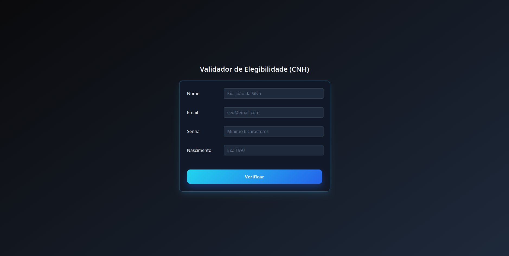

# 🚗 Validador de Elegibilidade para CNH

Projeto desenvolvido como conclusão de módulo de front-end do curso Full Stack, focado na criação de uma interface web responsiva, interativa e com validação de dados em tempo real utilizando HTML5, CSS3, JavaScript e Bootstrap.

---

## 📸 Preview



---

## ✨ Funcionalidades

- **Validação de Formulário:** Coleta e valida campos como Nome, E-mail, Senha e Ano de Nascimento.
- **Checagem de Elegibilidade:** Calcula automaticamente a idade do usuário com base no ano atual e verifica se ele possui a idade mínima legal (18 anos) para tirar a CNH.
- **Feedback Visual Dinâmico:** Os campos do formulário mudam de cor em tempo real (verde para dados válidos e vermelho para inválidos/inválidos preenchidos).
- **Interface Oculta / Alternância de Telas:** O formulário é substituído suavemente por um card de resultado personalizado (aprovado ou reprovado) ao submeter os dados.
- **Design Responsivo:** Layout centralizado e adaptado para diferentes tamanhos de tela (desktop, tablets e celulares).

---

## 🛠️ Tecnologias Utilizadas

Este projeto foi construído utilizando as seguintes tecnologias e ferramentas:

* **HTML5:** Estruturação semântica da página.
* **CSS3:** Estilização customizada, gradientes modernos, Flexbox e Media Queries para responsividade.
* **JavaScript (Vanilla):** Lógica de manipulação do DOM, controle de eventos, validações de regra de negócio e cálculo de idade.
* **Bootstrap (v5.0.2):** Framework CSS utilizado para agilizar o layout base e componentes utilitários.

---

## 📂 Estrutura de Arquivos

```text
📁 projeto-cnh/
│
├── index.html       # Estrutura principal da página
├── style.css        # Estilos customizados e regras de responsividade
├── script.js        # Lógica de validação, cálculo de idade e alternância de telas
└── preview.png      # Imagem de visualização do projeto